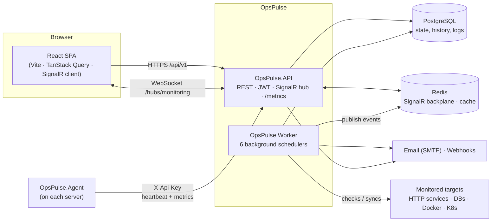
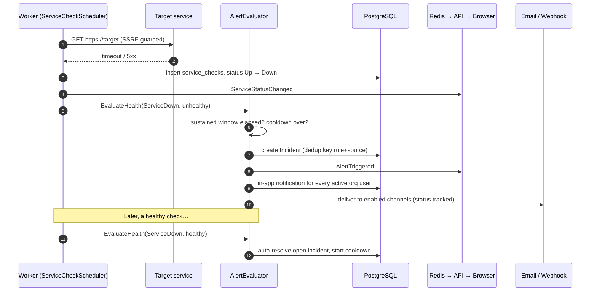

# OpsPulse — The Complete Guide

> Configure, run, verify, operate and extend every part of the OpsPulse
> monitoring platform. Every value in this guide (ports, intervals, limits,
> routes, config keys) was checked against the source code.

**How to use this guide**

- **New here?** Read [Part I](#part-i--understand-the-platform) (10 min), then follow
  [Part II](#part-ii--set-up--verify-step-by-step) phase by phase. Each phase ends with a
  **✅ Verify** checklist.
- **In a hurry?** Jump to the [15-minute smoke test](#the-15-minute-smoke-test).
- **Operating it in production?** [Part IV](#part-iv--operate-in-production) covers
  deployment, backups, upgrades, scaling limits and runbooks.
- **Looking something up?** [Part III](#part-iii--reference) is the reference: config
  keys, permissions, every REST endpoint, SignalR events, alert semantics.

---

## Table of contents

**Part I — Understand the platform**
1. [Architecture at a glance](#1-architecture-at-a-glance)
2. [How a failure becomes an alert](#2-how-a-failure-becomes-an-alert)
3. [Ports & URLs cheat sheet](#3-ports--urls-cheat-sheet)

**Part II — Set up & verify (step by step)**
- [Phase 0 — Prerequisites](#phase-0--prerequisites)
- [Phase 1 — Infrastructure (PostgreSQL + Redis)](#phase-1--infrastructure-postgresql--redis)
- [Phase 2 — Database schema](#phase-2--database-schema)
- [Phase 3 — Run the platform](#phase-3--run-the-platform)
- [Phase 4 — Accounts, organizations & users](#phase-4--accounts-organizations--users)
- [Phase 5 — Application monitoring (HTTP checks)](#phase-5--application-monitoring-http-checks)
- [Phase 6 — Server monitoring agent](#phase-6--server-monitoring-agent)
- [Phase 7 — Database monitoring](#phase-7--database-monitoring)
- [Phase 8 — Docker & Kubernetes](#phase-8--docker--kubernetes)
- [Phase 9 — Alerts, incidents & notifications](#phase-9--alerts-incidents--notifications)
- [Phase 10 — Reports, logs & audit](#phase-10--reports-logs--audit)
- [Phase 11 — Real-time (SignalR)](#phase-11--real-time-signalr)
- [Phase 12 — Observability of OpsPulse itself](#phase-12--observability-of-opspulse-itself)
- [The 15-minute smoke test](#the-15-minute-smoke-test)

**Part III — Reference**
- [R1 Configuration reference](#r1-configuration-reference)
- [R2 Roles & permissions matrix](#r2-roles--permissions-matrix)
- [R3 REST API reference](#r3-rest-api-reference)
- [R4 Using the API from the command line](#r4-using-the-api-from-the-command-line)
- [R5 Real-time events (SignalR)](#r5-real-time-events-signalr)
- [R6 Alerting semantics](#r6-alerting-semantics)
- [R7 Status definitions](#r7-status-definitions)
- [R8 Background jobs](#r8-background-jobs)
- [R9 Data model & retention](#r9-data-model--retention)

**Part IV — Operate in production**
- [O1 Deploy with Docker Compose](#o1-deploy-with-docker-compose)
- [O2 Deploy to Kubernetes](#o2-deploy-to-kubernetes)
- [O3 Run the agent as a service](#o3-run-the-agent-as-a-service)
- [O4 Backup & restore](#o4-backup--restore)
- [O5 Upgrades & migrations](#o5-upgrades--migrations)
- [O6 Scaling & known limitations](#o6-scaling--known-limitations)
- [O7 Runbooks](#o7-runbooks)
- [O8 Troubleshooting](#o8-troubleshooting)
- [O9 Security checklist](#o9-security-checklist)
- [FAQ](#faq) · [Glossary](#glossary)

---

# Part I — Understand the platform

## 1. Architecture at a glance

OpsPulse is a **modular monolith** with Clean Architecture
(`Domain ← Application ← Infrastructure ← API / Worker`), deployed as three
processes plus an optional agent on each monitored host.



| Process | What it does | Scale |
|---|---|---|
| **OpsPulse.API** | REST API, auth (JWT + API keys), SignalR hub, agent ingestion, on-demand checks, Prometheus `/metrics`, health checks, startup seeding (and optional migrations) | Horizontally (stateless apart from in-memory alert state — see [O6](#o6-scaling--known-limitations)) |
| **OpsPulse.Worker** | Scheduled HTTP checks, DB probes, Docker/K8s sync, stale-agent detection, retention | **Exactly one replica** |
| **Frontend** | Static SPA served by Vite (dev) or nginx (prod), proxies `/api`, `/hubs`, `/health` | Horizontally |
| **OpsPulse.Agent** | Collects CPU, RAM, disk, network on a host; posts every N seconds | One per host |

Both the API and the Worker write their own log lines to PostgreSQL
(`system_logs`) through a Serilog sink, and both publish SignalR events through
the Redis backplane — so a status change detected by the Worker reaches a
browser connected to any API replica.

## 2. How a failure becomes an alert



## 3. Ports & URLs cheat sheet

| What | Development | Docker Compose `full` | Kubernetes |
|---|---|---|---|
| Frontend | http://localhost:5173 | http://localhost:8090 | Ingress host `/` |
| API | http://localhost:5000 | http://localhost:8080 | Ingress `/api`, `/hubs`, `/health` |
| API reference (Scalar) | http://localhost:5000/scalar | *dev only* | *dev only* |
| OpenAPI JSON | http://localhost:5000/openapi/v1.json | *dev only* | *dev only* |
| Health (JSON) | http://localhost:5000/health | http://localhost:8080/health | `/health` |
| Prometheus metrics | http://localhost:5000/metrics | http://localhost:8080/metrics | in-cluster `api:8080/metrics` |
| SignalR hub | `/hubs/monitoring` | `/hubs/monitoring` | `/hubs/monitoring` |
| PostgreSQL | `localhost:5544` | `localhost:5544` (container `postgres:5432`) | bring your own |
| Redis | `localhost:6399` | `localhost:6399` (container `redis:6379`) | bring your own |

> **Why the odd ports?** OpsPulse deliberately uses **5544** and **6399** on the
> host so it never collides with a locally installed PostgreSQL (5432) or Redis
> (6379). Container-side ports stay standard.

---

# Part II — Set up & verify (step by step)

## Phase 0 — Prerequisites

| Tool | Minimum version | Check |
|---|---|---|
| .NET SDK | 10.0 | `dotnet --version` |
| Node.js | 20.19 / 22+ | `node --version` |
| Docker Desktop | with Compose v2 | `docker compose version` |
| Git | any recent | `git --version` |
| *(optional)* kubectl | any recent | `kubectl version --client` |
| *(optional)* jq | any | `jq --version` — used by the CLI examples |

Restore the pinned EF Core CLI (declared in `backend/.config/dotnet-tools.json`):

```bash
cd backend
dotnet tool restore        # installs dotnet-ef 10.0.14 locally
```

> **Windows users:** commands are shown in bash syntax. In PowerShell set
> environment variables with `$env:NAME = "value"` on a separate line before the
> command (PowerShell has no `NAME=value cmd` prefix). PowerShell variants are
> given wherever it matters.

## Phase 1 — Infrastructure (PostgreSQL + Redis)

```bash
cp .env.example .env          # dev credentials are pre-filled
docker compose up -d          # starts only postgres + redis (no profile)
docker compose ps             # wait until both show (healthy)
```

✅ **Verify**
- [ ] `docker exec opspulse-postgres psql -U opspulse -d opspulse -c "select 1;"` returns `1`
- [ ] `docker exec opspulse-redis redis-cli ping` returns `PONG`

## Phase 2 — Database schema

```bash
cd backend
ASPNETCORE_ENVIRONMENT=Development dotnet tool run dotnet-ef -- database update \
  --project OpsPulse.Infrastructure --startup-project OpsPulse.API
```

PowerShell:

```powershell
cd backend
$env:ASPNETCORE_ENVIRONMENT = "Development"
dotnet tool run dotnet-ef -- database update --project OpsPulse.Infrastructure --startup-project OpsPulse.API
```

> **Alternative:** set `Database__MigrateOnStartup=true` and the API applies
> pending migrations itself at startup. Container deployments do this by default
> ([O5](#o5-upgrades--migrations)).

✅ **Verify**
- [ ] `docker exec opspulse-postgres psql -U opspulse -d opspulse -c "\dt"` lists
      **30 tables**: 29 application tables plus `__EFMigrationsHistory`
      (see [R9](#r9-data-model--retention) for the full list).
- [ ] `... -c 'select "MigrationId" from "__EFMigrationsHistory";'` shows 4 migrations,
      the latest `…_AddLogsAndKubernetesOperations`.

On first API start the seeder creates the **5 roles** and the **SuperAdmin**
account from `Seed:SuperAdmin` (dev defaults: `admin@opspulse.dev` / `Admin#12345`).
Seeding is idempotent — restarting never duplicates anything.

## Phase 3 — Run the platform

Open three terminals:

```bash
# Terminal 1 — REST API + SignalR hub + Prometheus metrics
cd backend/OpsPulse.API && dotnet run
#    → http://localhost:5000   (API reference: /scalar, metrics: /metrics)

# Terminal 2 — monitoring engine (6 background services)
cd backend/OpsPulse.Worker && dotnet run
#    → look for the "… scheduler started (interval …)" lines

# Terminal 3 — frontend
cd frontend/opspulse-web && npm install && npm run dev
#    → http://localhost:5173  (proxies /api, /hubs, /health to :5000)
```

The Worker hosts these background services ([R8](#r8-background-jobs) has details):

| Service | Interval |
|---|---|
| HTTP service checks | 10 s tick (each service runs on its own interval, ≥ 10 s) |
| Stale-agent detection | 30 s |
| Docker sync | 30 s |
| Database probes | 60 s |
| Kubernetes sync | 60 s |
| Retention cleanup | 6 h |

✅ **Verify**
- [ ] `curl http://localhost:5000/health` → `"status":"Healthy"` with `postgresql` and `redis` entries
- [ ] `curl http://localhost:5000/api/v1/health` → service name, version, environment
- [ ] Worker console shows `Service check scheduler started (interval 10s)`,
      `Database check scheduler started (interval 60s)`,
      `Kubernetes sync scheduler started (interval 60s)`,
      `Docker sync scheduler started (interval 30s)`
- [ ] Frontend loads; the login page shows the seed credentials hint

## Phase 4 — Accounts, organizations & users

OpsPulse is **multi-tenant**: every monitored resource belongs to exactly one
organization, and users only ever see their own organization's data.

| Account | Role | Purpose |
|---|---|---|
| `admin@opspulse.dev` / `Admin#12345` (dev) | **SuperAdmin** | Platform oversight: lists all organizations and users, manages users everywhere, sees events from every org. Has no organization of its own, so it **cannot create org-scoped resources** (services, databases …). |
| Created via `/register` | **OrganizationAdmin** | Owns an organization; creates and manages all its monitoring resources and users. |

**Register an organization**
1. Open `http://localhost:5173/register`.
2. Fill in organization name, your name, email, password.
   Password policy: **at least 10 characters with upper case, lower case, a digit and a
   special character**, e.g. `Str0ng!Passw0rd`.
3. Submit — you are signed in immediately as the organization's admin.

**Add teammates** — *Users → Create user*, pick a role:

| Role | Can do |
|---|---|
| `OrganizationAdmin` | Everything in the org, incl. users, org settings and the audit log |
| `DevOpsEngineer` | Full monitoring configuration (services, servers, DBs, Docker, K8s, rules, channels, API keys, system logs) |
| `Operator` | Operate: "check now", read pod logs, acknowledge/comment/resolve incidents |
| `Viewer` | Read-only |

The full matrix is in [R2](#r2-roles--permissions-matrix). Guard rails enforced by the API:
only a SuperAdmin can create, modify or grant SuperAdmin; nobody can change their own
role or deactivate themselves. Deactivating a user (shield icon) revokes their sessions
immediately.

**Sign-in security facts**
- Access tokens live **15 minutes** and are refreshed automatically by the frontend.
- Refresh tokens live **7 days**, are stored hashed, are **rotated on every use**, and
  replaying an already-rotated token revokes the whole token chain.
- **5 failed logins** lock the account for **15 minutes**.
- All `/api/v1/auth/*` endpoints are rate limited to **20 requests per minute per client IP**
  (HTTP 429 beyond that).

✅ **Verify**
- [ ] Dashboard shows your organization name; sidebar shows all modules
- [ ] Create a `Viewer`, sign in as them in a private window → create/edit buttons are
      rejected by the API with 403 even if you call the endpoint directly
- [ ] Six wrong passwords in a row → the account is locked (try again after 15 min)

## Phase 5 — Application monitoring (HTTP checks)

1. **Applications → Add application**
2. Fill in:

| Field | Rules | Example |
|---|---|---|
| Name | required, ≤ 200 chars | `OpsPulse API` |
| URL | absolute `http`/`https`, ≤ 2048 chars | `http://localhost:5000/api/v1/health` |
| Environment | Development / Staging / Production | Development |
| Check interval | **10 – 3600 s** | 30 |
| Timeout | **1 – 60 s** | 10 |
| Expected status codes | codes or ranges, comma-separated (default `200-299`) | `200`, `200,204`, `200-399` |

3. Within one scheduler tick (≤ 10 s) the first check runs.

**How a check is judged** ([R7](#r7-status-definitions)): an expected status code
within `Monitoring:DegradedResponseTimeMs` (default 2000 ms) → **Up**; expected
code but slower → **Degraded**; anything else (unexpected code, timeout, DNS/TLS
error, blocked address) → **Down**. Redirects are **followed** (up to 5 hops, each hop
SSRF-checked, never HTTPS → HTTP) and the **final** response is judged. An app that
answers `302 → /Account/Login` is therefore **Up** when its login page returns 200.

> **SSRF protection.** Checks resolve DNS inside the socket connect callback and
> refuse non-public addresses *before* a socket opens, which also defeats DNS
> rebinding. Blocked: loopback, RFC 1918 private ranges, link-local (incl. the
> cloud metadata address `169.254.169.254`), CGNAT `100.64.0.0/10`, multicast and
> reserved ranges, IPv6 loopback/link-local/unique-local (`fc00::/7`), and
> IPv4-mapped IPv6 forms of all of those. Development settings set
> `Monitoring:AllowPrivateNetworks=true` so you can monitor `localhost`;
> production defaults to `false`. Webhook deliveries use the same policy.

✅ **Verify**
- [ ] Card shows **Up** with a response time
- [ ] "Check now" (activity icon) → toast with status and latency
- [ ] Open the service → live response-time chart + check history (auto-refreshes)
- [ ] Add a service pointing to `http://localhost:59999` → **Down**, consecutive failures increase
- [ ] Add a service with an artificially slow endpoint, or lower
      `Monitoring:DegradedResponseTimeMs` to `1` → **Degraded**

## Phase 6 — Server monitoring agent

1. **Monitoring Agents → Create API key** → copy the key. It looks like `ops_…`,
   is **shown once**, and only its SHA-256 hash is stored. Each key belongs to your
   organization; servers registered with it appear only there.
2. Start the agent on the machine to monitor:

```bash
cd backend/OpsPulse.Agent
OpsPulse__ApiUrl=http://localhost:5000 \
OpsPulse__ApiKey=ops_xxxxxxxxxxxxxxxx \
OpsPulse__IntervalSeconds=15 \
dotnet run
```

PowerShell:

```powershell
cd backend/OpsPulse.Agent
$env:OpsPulse__ApiUrl = "http://localhost:5000"
$env:OpsPulse__ApiKey = "ops_xxxxxxxxxxxxxxxx"
$env:OpsPulse__IntervalSeconds = "15"
dotnet run
```

| Setting | Default | Meaning |
|---|---|---|
| `OpsPulse__ApiUrl` | `http://localhost:5000` | API base URL (no trailing `/api`) |
| `OpsPulse__ApiKey` | — (**required**) | Key from step 1; sent as the `X-Api-Key` header |
| `OpsPulse__IntervalSeconds` | `30` | Seconds between reports |

3. The agent first sends a **heartbeat** (hostname, IP, OS, CPU cores, total RAM) which
   registers or updates the server, then posts a **metrics** sample every interval:
   CPU %, memory used/total, disk used %, network in/out Mbps.

| Platform | Data source | Notes |
|---|---|---|
| Windows | Performance counters | CPU, memory, disk |
| Linux | `/proc` | CPU, memory, disk, network |
| Other | — | Heartbeats work; metrics report zeros |

For running the agent permanently (systemd, Windows, Docker) see [O3](#o3-run-the-agent-as-a-service).

✅ **Verify**
- [ ] **Servers**: the host shows **Online** with live CPU/memory percentages
- [ ] Click the server name → detail page with a streaming CPU + memory chart
- [ ] Stop the agent (Ctrl+C) → within **90–120 s** the server flips **Offline**
      (`Monitoring:AgentOfflineAfterSeconds` = 90, checked every 30 s) and an
      `AgentDisconnected` event fires
- [ ] Start it again → server returns **Online** and an `AgentConnected` event fires

## Phase 7 — Database monitoring

1. **Databases → Register database**
2. Choose **PostgreSQL** or **SQL Server**; enter host, port, database, user, password.
   The password is encrypted with **AES-256-GCM** before storage
   (key: `Encryption:Key`, 64 hex chars) and is never returned by the API.
3. The first probe runs within 60 s.

Each probe records: reachability, probe latency, active connections, max connections
and database size. Health is **Unreachable** if the probe fails, **Degraded** if it takes
more than 2000 ms, otherwise **Healthy**.

> Use a **read-only, least-privilege** login. PostgreSQL needs only `CONNECT` and read
> access to `pg_stat_activity` / `pg_settings` / `pg_database_size`; on SQL Server grant
> `VIEW SERVER STATE`.
>
> **SQL Server note:** max connections comes from the `user connections` setting, which
> defaults to `0` (= unlimited). In that case utilization can't be computed and
> `DatabaseConnectionUtilization` rules don't evaluate for that server.

### Managing a registered database

| Action | Where | Who | What happens |
|---|---|---|---|
| **Check now / test connection** | activity icon on the card, or *Check now* on the details page | Operator+ | Probes immediately, records the sample, toast shows latency, connections and size or the exact error |
| **View history** | click the database name → `/databases/{id}` | everyone | Charts for active vs. max connections, probe latency and size over the last 100 probes (~100 min); availability %, peak connections, size growth, recent failures |
| **Edit** | pencil icon / *Edit* | DevOpsEngineer+ | Change name, host, port, database, user. Leave **New password** empty to keep the stored one, or type a new one to rotate it. Saving runs a connection test straight away. The type (PostgreSQL / SQL Server) can't change; register a new connection instead. |
| **Pause / Resume** | pause icon / *Pause* | DevOpsEngineer+ | Paused databases aren't probed and raise no alerts; history is kept. Use it for maintenance windows. |
| **Remove** | trash icon / *Remove* | DevOpsEngineer+ | Deletes the connection, its encrypted credentials and its metric history |

The cards also show the latest **connections (active / max)**, **utilization %**
(amber at ≥ 80 %), **size** and **latency**, plus a summary row of healthy, degraded,
unreachable and paused databases. Every edit is recorded in the Audit Log.

**Alert ideas for databases:** *DB connection utilization (%) > 80*, sustained 5 min →
pool exhaustion early warning. *Unreachable* databases are visible on the card and in
the details page's failure list.

✅ **Verify**
- [ ] Click *Check now* → toast with latency, connections and size
- [ ] Edit → change the password to a wrong one → *Save & test* reports the login error;
      set it back → Healthy again
- [ ] Pause → card greys out and *Last check* stops advancing; Resume → checks continue
- [ ] Register the platform's own database (`localhost:5544`, db `opspulse`, user
      `opspulse`, password `opspulse_dev`) → card turns **Healthy** with real numbers
- [ ] Register a wrong password → **Unreachable** with the error message
- [ ] Create an alert rule *Database connection utilization (%) > 1* → incident within ~60 s

## Phase 8 — Docker & Kubernetes

### Docker

1. **Docker → Add Docker host** → endpoint:
   - Windows (Docker Desktop): `npipe://./pipe/docker_engine`
   - Linux / macOS: `unix:///var/run/docker.sock`
   - Remote: `tcp://host:2376` (protect it with TLS — an open Docker socket is root access)
2. The first sync runs immediately; the Worker refreshes every 30 s.

✅ **Verify:** the host card shows `N running / M containers`; click it for the container
table with CPU % and memory. `docker stop opspulse-redis` → it shows as exited on the next
sync (start it again afterwards!).

### Kubernetes

1. **Kubernetes → Add cluster** → name + optional kubeconfig YAML.
   - **Empty kubeconfig** → in-cluster service account when OpsPulse itself runs in
     Kubernetes, otherwise the Worker's `~/.kube/config` (Docker Desktop / minikube dev).
   - **Pasted kubeconfig** → encrypted with AES-GCM at rest and only ever decrypted
     in memory. It must be self-contained (embedded certificates/tokens, not file paths).
2. If the cluster is unreachable it is marked with the error — nothing else breaks.

Each sync (60 s) lists **nodes**, **pods** (all namespaces: phase, restarts) and
**deployments** (desired/ready replicas, image).

**Control operations**

| Operation | UI | Required role | Kubernetes RBAC verb |
|---|---|---|---|
| View pod logs (100–1000 lines, previous container, 5 s auto-refresh) | file icon on a pod row | Operator+ | `get pods/log` |
| Restart pod (delete → controller recreates) | rotate icon | DevOpsEngineer+ | `delete pods` |
| Scale deployment (0 suspends it) | pencil icon on a deployment row | DevOpsEngineer+ | `get`/`patch deployments/scale` |

Every restart and scale is written to the **Audit Log**.

**Least-privilege RBAC for OpsPulse** — read-only monitoring plus the three
operations above. Leave out the last two rules if you want monitoring only:

```yaml
apiVersion: v1
kind: ServiceAccount
metadata: { name: opspulse-monitor, namespace: opspulse }
---
apiVersion: rbac.authorization.k8s.io/v1
kind: ClusterRole
metadata: { name: opspulse-monitor }
rules:
  # monitoring (required)
  - apiGroups: [""]
    resources: [nodes, pods]
    verbs: [get, list]
  - apiGroups: ["apps"]
    resources: [deployments]
    verbs: [get, list]
  - apiGroups: [""]
    resources: [pods/log]
    verbs: [get]
  # control operations (optional)
  - apiGroups: [""]
    resources: [pods]
    verbs: [delete]
  - apiGroups: ["apps"]
    resources: [deployments/scale]
    verbs: [get, patch]
---
apiVersion: rbac.authorization.k8s.io/v1
kind: ClusterRoleBinding
metadata: { name: opspulse-monitor }
roleRef: { apiGroup: rbac.authorization.k8s.io, kind: ClusterRole, name: opspulse-monitor }
subjects:
  - { kind: ServiceAccount, name: opspulse-monitor, namespace: opspulse }
```

✅ **Verify**
- [ ] Cluster card shows node / pod / failed-pod counts
- [ ] Nodes, deployments and pods tables populate after the sync
- [ ] Pod logs match `kubectl logs <pod> -n <ns> --tail=200`
- [ ] Scaling a deployment changes its replica badge and `kubectl get deploy` agrees
- [ ] The Audit Log has an entry for each restart/scale

## Phase 9 — Alerts, incidents & notifications

### Create a rule — Alert Rules → Create rule

| Field | Meaning |
|---|---|
| Metric | What is evaluated (table below) |
| Comparator / threshold | `GreaterThan` or `LessThan` a number (ignored for health metrics) |
| Sustained minutes (0–1440) | How long the breach must hold before an incident opens (0 = immediately) |
| Cooldown minutes (0–1440) | After an auto-resolve, how long a new breach is ignored |
| Severity | `Informational`, `Warning`, `Critical` |
| Target service | Optional: limit a service rule to one service; empty = all |

| Metric (UI label) | Kind | Evaluated by | When |
|---|---|---|---|
| Service unavailable (`ServiceDown`) | health | Worker (and API on "check now") | every HTTP check |
| Response time ms (`ResponseTime`) | threshold | Worker / API | every **successful** HTTP check |
| CPU usage % (`CpuUsage`) | threshold | API | every agent metrics post |
| Memory usage % (`MemoryUsage`) | threshold | API | every agent metrics post |
| Disk usage % (`DiskUsage`) | threshold | API | every agent metrics post (when reported) |
| DB connection utilization % (`DatabaseConnectionUtilization`) | threshold | Worker | every DB probe (active ÷ max × 100) |
| Agent heartbeat missing (`AgentHeartbeat`) | health | Worker (breach) / API (recovery) | every 30 s while a server is Offline |

Full semantics (dedup keys, sustained windows, cooldowns, auto-resolve) are in [R6](#r6-alerting-semantics).

### Test the full chain

1. Add a service pointing at a dead URL (Phase 5).
2. Create rule: metric `Service unavailable`, severity `Critical`, sustained `0`.
3. Within ~10 s: an **incident appears automatically** — one per rule + source, never duplicates.
4. The header bell shows a badge; **Notifications** lists the alert.
5. Open the incident → timeline shows *Created*; **Acknowledge**, add a comment, then **Resolve**.
6. Alternatively fix the service URL → the next healthy check **auto-resolves** the open incident.
7. While the condition stays bad, each further check adds a *Recurring* event to the open incident.

### Notification channels — Alert Rules → Add channel

Every alert always creates an **in-app notification for every active user** of the
organization. On top of that, each enabled channel is delivered and tracked
(`Pending → Sent / Failed / Skipped`):

| Channel | Target | Behaviour |
|---|---|---|
| Email | recipient address | Needs `Smtp:Host`; without it deliveries are marked **Skipped** |
| Webhook | `https://…` URL | `POST` JSON (below); **any non-2xx response is marked Failed**; 10 s timeout; redirects not followed; SSRF policy applies |

Webhook payload:

```json
{
  "id": "6f1c0e8e-2b0a-4d8e-9f51-0d2f7a6f1b3c",
  "title": "API down — OpsPulse API",
  "description": "Alert rule \"API down\" breached: Check error: Connection refused.",
  "severity": "Critical",
  "source": "OpsPulse API",
  "startedAtUtc": "2026-11-09T08:15:02.123Z"
}
```

> **Slack / Teams / PagerDuty** expect their own JSON shapes. Point the webhook at a
> small relay (an Azure Function, AWS Lambda, n8n or Zapier flow) that reshapes the
> payload, or use the email channel with the tool's inbound-email address.

✅ **Verify**
- [ ] Incident row updates to *Resolved* after the fix
- [ ] Bell badge clears after "mark all read"
- [ ] A webhook to https://webhook.site shows the payload above; one to a URL returning
      500 shows **Failed** in Notifications
- [ ] With cooldown 5 min: break → incident, fix → auto-resolve, break again within 5 min →
      **no** new incident; after 5 min → new incident

## Phase 10 — Reports, logs & audit

| Page | What you get | Who |
|---|---|---|
| **Reports** | Uptime % per service, incident summary with average resolution time, server CPU/memory averages and peaks — for 24 h / 7 d / 30 d — plus **CSV export** | everyone |
| **System Logs** | Every log line of the API and Worker (Serilog → PostgreSQL). Level and source filters, full-text search, expandable exceptions, **Live tail** (3 s refresh) | DevOpsEngineer+ |
| **Audit Logs** | Logins, monitoring changes, user changes, incident actions, K8s operations — with actor, IP and timestamp. Search and filter by action | OrganizationAdmin+ |
| **System Settings** | Runtime version, environment, live dependency health | everyone |

> The log pipeline uses a bounded in-process queue: under extreme log volume the
> **oldest** queued events are dropped rather than slowing the application down. The
> console output is always complete.

✅ **Verify**
- [ ] Reports uptime numbers match the service's check history
- [ ] CSV export opens in a spreadsheet
- [ ] System Logs fills with new lines while Live tail is on; filter `Level = Warning`
- [ ] The Audit Log contains the actions you performed in Phases 4–9

## Phase 11 — Real-time (SignalR)

The browser connects to `/hubs/monitoring` with its JWT (sent as the `access_token`
query parameter, because WebSockets can't carry headers). The hub puts the connection
in its organization's group (`org:{id}`); SuperAdmins join the `platform` group and
receive every organization's events. Events are listed in [R5](#r5-real-time-events-signalr).

1. Open the dashboard in two browser windows.
2. In window 2 click "check now" on a service, or stop a target to cause a status change.
3. Window 1 updates **without a reload**.

✅ **Verify**
- [ ] The dashboard updates live on `ServiceStatusChanged`
- [ ] The header bell increments live when an alert fires (`AlertTriggered`)
- [ ] DevTools → Network → WS shows one open `/hubs/monitoring` connection

## Phase 12 — Observability of OpsPulse itself

- **`GET /health`** — JSON report with the PostgreSQL and Redis checks and their
  latency. Use it for load balancer and Kubernetes probes.
- **`GET /metrics`** — Prometheus text format: .NET runtime and process metrics, plus
  **HTTP request count and duration histograms per endpoint**
  (`http_requests_received_total`, `http_request_duration_seconds`).
- **Logs** — console (stdout) for your log platform, plus the System Logs page.

Prometheus scrape config: `infrastructure/prometheus/prometheus.yml` (targets `api:8080`
and an optional `postgres-exporter:9187`, which you deploy yourself).

Useful PromQL:

```promql
# request rate per endpoint
sum by (endpoint) (rate(http_requests_received_total[5m]))

# p95 latency per endpoint
histogram_quantile(0.95, sum by (le, endpoint) (rate(http_request_duration_seconds_bucket[5m])))

# 5xx error ratio
sum(rate(http_requests_received_total{code=~"5.."}[5m])) / sum(rate(http_requests_received_total[5m]))
```

✅ **Verify:** `curl -s localhost:5000/metrics | grep http_requests_received_total` returns series.

## The 15-minute smoke test

Run this after every deployment or upgrade. Everything should be green.

| # | Check | Expected |
|---|---|---|
| 1 | `GET /health` | `Healthy`, postgresql + redis present |
| 2 | Log in as an org admin | Dashboard loads, org name shown |
| 3 | Add service → `https://example.com` | **Up** within 10 s |
| 4 | Add service → `https://example.invalid` | **Down** |
| 5 | Rule *Service unavailable* (Critical, 0 min) | Incident for #4 within 10 s, bell badge increments live |
| 6 | Delete service #4 | No new recurring events |
| 7 | Resolve the incident | Status Resolved, timeline entry |
| 8 | Create API key, run the agent for 1 min | Server Online with CPU/RAM |
| 9 | Register the platform DB | Healthy |
| 10 | Reports → 24 h | Uptime rows for #3 |
| 11 | System Logs | Fresh API + Worker entries |
| 12 | Audit Logs | Entries for steps 3–9 |
| 13 | `GET /metrics` | HTTP metrics present |

---

# Part III — Reference

## R1 Configuration reference

Configuration comes from `appsettings.json`, `appsettings.{Environment}.json` and
**environment variables** (which win). In environment variables replace `:` with `__`
(e.g. `Jwt:Key` → `Jwt__Key`).

### Required in production

| Key | Process | Description | Generate with |
|---|---|---|---|
| `ConnectionStrings:DefaultConnection` | API, Worker | Npgsql connection string | — |
| `ConnectionStrings:Redis` | API, Worker | e.g. `redis:6379,abortConnect=false` | — |
| `Jwt:Key` | API | HMAC signing key, **64+ random characters** | `openssl rand -base64 64` |
| `Encryption:Key` | API, Worker | AES-256-GCM key, **64 hex chars**; must be **identical** in API and Worker | `openssl rand -hex 32` |
| `Seed:SuperAdmin:Password` | API | Initial SuperAdmin password (policy applies) | password manager |

> ⚠️ **Never lose or change `Encryption:Key`** once data exists: stored database
> passwords and kubeconfigs become undecryptable. Back it up with the database.

### Optional

| Key | Default | Process | Description |
|---|---|---|---|
| `Seed:SuperAdmin:Email` | `admin@opspulse.dev` | API | SuperAdmin login; seeding is skipped if email or password is empty |
| `Jwt:Issuer` / `Jwt:Audience` | `OpsPulse.API` / `OpsPulse.Web` | API | Token issuer/audience |
| `Jwt:AccessTokenLifetimeMinutes` | `15` | API | Access-token lifetime |
| `Jwt:RefreshTokenLifetimeDays` | `7` | API | Refresh-token lifetime |
| `Cors:AllowedOrigins` | `["http://localhost:5173"]` | API | Allowed browser origins (array: `Cors__AllowedOrigins__0=…`) |
| `Database:MigrateOnStartup` | `false` (`true` in compose/K8s) | API | Apply pending EF migrations before seeding |
| `Monitoring:AllowPrivateNetworks` | `false` (`true` in Development) | API, Worker | Allow checks/webhooks to private and loopback addresses |
| `Monitoring:DegradedResponseTimeMs` | `2000` | API, Worker | Successful checks slower than this are **Degraded** |
| `Monitoring:AgentOfflineAfterSeconds` | `90` | Worker | Heartbeat age after which a server is **Offline** |
| `Monitoring:RetentionDays` | `30` | Worker | Age after which history and logs are deleted |
| `Monitoring:AgentRecommendedIntervalSeconds` | `30` | API | Interval returned to agents in the heartbeat response |
| `Smtp:Host` | — | API, Worker | SMTP server; email channel is **Skipped** when empty |
| `Smtp:Port` | `587` | API, Worker | SMTP port |
| `Smtp:UserName` / `Smtp:Password` | — | API, Worker | SMTP credentials |
| `Smtp:FromEmail` / `Smtp:FromName` | `opspulse@localhost` / `OpsPulse` | API, Worker | Sender |
| `Serilog:MinimumLevel:Default` | `Information` | API | Log level (Worker is fixed at Information) |

### Docker Compose `.env` variables

| Variable | Used for | Required for `--profile full` |
|---|---|---|
| `POSTGRES_USER` / `POSTGRES_PASSWORD` / `POSTGRES_DB` | Database container + connection strings | no (dev defaults) |
| `JWT_KEY` | `Jwt__Key` | **yes** |
| `ENCRYPTION_KEY` | `Encryption__Key` (API and Worker) | **yes** |
| `SEED_ADMIN_EMAIL` | `Seed__SuperAdmin__Email` | no |
| `SEED_ADMIN_PASSWORD` | `Seed__SuperAdmin__Password` | **yes** |

## R2 Roles & permissions matrix

Authorization is **enforced by the API** through policies; the UI only hides what you
can't use. ✅ = allowed.

| Capability (policy) | SuperAdmin | OrgAdmin | DevOps | Operator | Viewer |
|---|:-:|:-:|:-:|:-:|:-:|
| View dashboards, services, servers, DBs, Docker, K8s, incidents, reports, notifications | ✅ | ✅ | ✅ | ✅ | ✅ |
| "Check now", read pod logs (`CanOperateMonitoring`) | ✅ | ✅ | ✅ | ✅ | |
| Acknowledge / comment / resolve incidents (`CanManageIncidents`) | ✅ | ✅ | ✅ | ✅ | |
| Create/edit/delete monitored resources, rules, channels; API keys; restart pods; scale deployments; System Logs (`CanManageMonitoring`) | ✅¹ | ✅ | ✅ | | |
| Manage users (`CanManageUsers`) | ✅ | ✅ | | | |
| Organization settings, Audit Log (`CanManageOrganization`) | ✅ | ✅ | | | |
| List all organizations (`CanManagePlatform`) | ✅ | | | | |

¹ A SuperAdmin has no organization, so creating org-scoped resources is refused.

## R3 REST API reference

Base path `/api/v1`. All endpoints need a JWT (`Authorization: Bearer …`) unless marked.
Enums are sent and returned as **strings** (e.g. `"Critical"`). Errors use RFC 9110
**problem details** (`application/problem+json`); validation errors return 400 with
per-field messages. In Development the interactive reference is at **`/scalar`**.

**Auth** (rate limited 20/min/IP)

| Method | Path | Policy | Notes |
|---|---|---|---|
| POST | `/auth/register` | anonymous | `{organizationName, fullName, email, password}` → tokens |
| POST | `/auth/login` | anonymous | `{email, password}` → `{accessToken, refreshToken, expiresAtUtc, user}` |
| POST | `/auth/refresh` | anonymous | rotates the refresh token |
| POST | `/auth/logout` | authenticated | revokes the refresh token |
| GET | `/auth/me` | authenticated | current profile |

**Monitoring**

| Method | Path | Policy |
|---|---|---|
| GET | `/services`, `/services/{id}` | authenticated |
| POST · PUT · DELETE | `/services`, `/services/{id}` | CanManageMonitoring |
| POST | `/services/{id}/check` | CanOperateMonitoring |
| GET | `/servers`, `/servers/{id}` | authenticated |
| PUT · DELETE | `/servers/{id}` | CanManageMonitoring |
| GET | `/databases`, `/databases/{id}` | authenticated |
| POST · PUT · DELETE | `/databases`, `/databases/{id}` (PUT: omit `password` to keep it; `isActive` pauses/resumes) | CanManageMonitoring |
| POST | `/databases/{id}/check` (probe now, returns the sample) | CanOperateMonitoring |
| GET | `/docker`, `/docker/{id}` | authenticated |
| POST · DELETE | `/docker`, `/docker/{id}`; POST `/docker/{id}/sync` | CanManageMonitoring |
| GET | `/kubernetes`, `/kubernetes/{id}` | authenticated |
| POST · DELETE | `/kubernetes`, `/kubernetes/{id}`; POST `/kubernetes/{id}/sync` | CanManageMonitoring |
| GET | `/kubernetes/{id}/pods/logs?namespaceParameter=&pod=&lines=200&previous=false` | CanOperateMonitoring |
| POST | `/kubernetes/{id}/pods/{namespace}/{pod}/restart` | CanManageMonitoring |
| POST | `/kubernetes/{id}/deployments/{namespace}/{name}/scale` | CanManageMonitoring |

**Operations**

| Method | Path | Policy |
|---|---|---|
| GET | `/alert-rules`, `/alert-rules/channels` | authenticated |
| POST · PUT · DELETE | `/alert-rules`, `/alert-rules/{id}`, `/alert-rules/channels`, `/alert-rules/channels/{id}` | CanManageMonitoring |
| GET | `/incidents?page&pageSize&search&status&severity`, `/incidents/{id}` | authenticated |
| POST | `/incidents/{id}/acknowledge`, `/resolve`, `/comments` | CanManageIncidents |
| GET | `/notifications?page&pageSize&unreadOnly`, `/notifications/unread-count` | authenticated |
| POST | `/notifications/{id}/read`, `/notifications/read-all` | authenticated |
| GET | `/reports/uptime?hours=24`, `/reports/incidents`, `/reports/servers`, `/reports/uptime/export` (CSV) | authenticated |
| GET | `/logs?page&pageSize&search&level&source` | CanManageMonitoring |
| GET | `/audit-logs?page&pageSize&search&action` | CanManageOrganization |

**Platform**

| Method | Path | Policy |
|---|---|---|
| GET | `/users` | authenticated (tenant-scoped) |
| POST · PUT | `/users`, `/users/{id}` | CanManageUsers |
| GET | `/organizations` | CanManagePlatform |
| GET · PUT | `/organizations/current` | authenticated · CanManageOrganization |
| GET · POST · DELETE | `/api-keys`, `/api-keys/{id}` | CanManageMonitoring |
| POST | `/agents/heartbeat`, `/agents/metrics` | **API key** (`X-Api-Key`) |
| GET | `/health` | anonymous |

**Root endpoints:** `GET /health` · `GET /metrics` · `GET /openapi/v1.json` (dev) ·
`GET /scalar` (dev) · hub `/hubs/monitoring`.

## R4 Using the API from the command line

```bash
API=http://localhost:5000/api/v1

# 1. Log in and keep the access token
TOKEN=$(curl -s -X POST $API/auth/login -H 'Content-Type: application/json' \
  -d '{"email":"you@acme.io","password":"Str0ng!Passw0rd"}' | jq -r .accessToken)
AUTH="Authorization: Bearer $TOKEN"

# 2. Create a monitored service
SVC=$(curl -s -X POST $API/services -H "$AUTH" -H 'Content-Type: application/json' -d '{
  "name": "Example", "url": "https://example.com", "description": null,
  "environment": "Production", "checkIntervalSeconds": 30,
  "timeoutSeconds": 10, "expectedStatusCodes": "200"
}' | jq -r .id)

# 3. Run a check now
curl -s -X POST $API/services/$SVC/check -H "$AUTH" | jq

# 4. Alert when any service is down for 2 minutes
curl -s -X POST $API/alert-rules -H "$AUTH" -H 'Content-Type: application/json' -d '{
  "name": "Service down", "metric": "ServiceDown", "comparator": "GreaterThan",
  "threshold": 0, "durationMinutes": 2, "cooldownMinutes": 10,
  "severity": "Critical", "targetServiceId": null
}' | jq

# 5. Webhook channel
curl -s -X POST $API/alert-rules/channels -H "$AUTH" -H 'Content-Type: application/json' \
  -d '{"name":"Ops webhook","type":"Webhook","target":"https://webhook.site/your-id"}' | jq

# 6. Open incidents
curl -s "$API/incidents?status=Open" -H "$AUTH" | jq '.items[] | {title, severity, status}'

# 7. 7-day uptime as CSV
curl -s "$API/reports/uptime/export?hours=168" -H "$AUTH" -o uptime.csv
```

Agent-style calls (for custom collectors — any script can act as an agent):

```bash
KEY=ops_xxxxxxxxxxxxxxxx
SERVER=$(curl -s -X POST $API/agents/heartbeat -H "X-Api-Key: $KEY" -H 'Content-Type: application/json' -d '{
  "hostname":"db-01","name":"db-01","ipAddress":"10.0.0.12","osName":"Linux",
  "osVersion":"Ubuntu 24.04","agentVersion":"custom-1","cpuCores":8,"totalMemoryMb":32768
}' | jq -r .serverId)

curl -s -X POST $API/agents/metrics -H "X-Api-Key: $KEY" -H 'Content-Type: application/json' -d "{
  \"serverId\":\"$SERVER\",
  \"metrics\":[{\"collectedAtUtc\":\"$(date -u +%FT%TZ)\",\"cpuUsagePercent\":42.5,
    \"memoryUsedMb\":12000,\"memoryTotalMb\":32768,\"diskUsedPercent\":71,
    \"networkInMbps\":3.2,\"networkOutMbps\":1.1}]
}"
```

A metrics batch accepts up to **100 samples**; CPU and disk are clamped to 0–100.

## R5 Real-time events (SignalR)

Hub: `/hubs/monitoring` · auth: JWT via `access_token` query string · groups: `org:{organizationId}` and `platform` (SuperAdmins).

| Event | Raised when | Raised by |
|---|---|---|
| `ServiceStatusChanged` | a service's status changes (Up/Degraded/Down) | Worker, API (check now) |
| `MetricsUpdated` | new agent metrics, or a database health change | API, Worker |
| `AgentConnected` | a server comes (back) online | API |
| `AgentDisconnected` | a server is marked offline | Worker |
| `AlertTriggered` | an alert rule opens an incident | Worker, API |
| `IncidentCreated` / `IncidentUpdated` / `IncidentResolved` | incident lifecycle changes | Worker, API |

Minimal client:

```ts
import { HubConnectionBuilder } from '@microsoft/signalr'

const connection = new HubConnectionBuilder()
  .withUrl('/hubs/monitoring', { accessTokenFactory: () => accessToken })
  .withAutomaticReconnect()
  .build()

connection.on('ServiceStatusChanged', (e) => console.log(e.name, '→', e.status))
connection.on('AlertTriggered', (incident) => console.log('ALERT', incident.title))
await connection.start()
```

## R6 Alerting semantics

- **Deduplication key** — `rule:{ruleId}:source:{sourceId}`. At most **one open
  incident** exists per rule and source; further breaches add *Recurring* events to it.
- **Health metrics** (`ServiceDown`, `AgentHeartbeat`) breach when the source is
  unhealthy; threshold and comparator are ignored.
- **Threshold metrics** breach when `value > threshold` (`GreaterThan`) or
  `value < threshold` (`LessThan`).
- **Sustained window** — the incident opens only once the condition has held for
  `DurationMinutes` without a healthy evaluation in between. A single healthy sample
  resets the timer.
- **Auto-resolve** — the first healthy evaluation resolves the open incident
  (`Auto-resolved: condition cleared.`, actor `OpsPulse`).
- **Cooldown** — after an auto-resolve, new breaches are ignored for
  `CooldownMinutes`. This stops a flapping target from opening an incident on every flap.
- **Scope** — `TargetServiceId` narrows service rules to one service. Server and
  database rules apply to every server/database of the organization.
- **Severity** — the incident inherits the rule's severity.
- **Recipients** — in-app: every active user of the organization; plus every enabled
  Email / Webhook channel of the organization.
- **State** — the sustained/cooldown timers live **in the memory of the process that
  evaluates** (table in [Phase 9](#phase-9--alerts-incidents--notifications)). They reset
  on restart; open incidents and auto-resolve are stored in the database and are not
  affected. See [O6](#o6-scaling--known-limitations).

**Recipes**

| Goal | Rule |
|---|---|
| Page on any outage | `ServiceDown`, sustained 0, cooldown 5, Critical |
| Ignore one-off blips | `ServiceDown`, sustained 2, cooldown 10, Warning |
| Slow API | `ResponseTime > 1500`, sustained 5, Warning, target = that service |
| Hot CPU | `CpuUsage > 85`, sustained 10, Warning |
| Disk filling | `DiskUsage > 90`, sustained 0, Critical |
| Pool exhaustion | `DatabaseConnectionUtilization > 80`, sustained 5, Warning |
| Host down | `AgentHeartbeat`, sustained 2, Critical |

## R7 Status definitions

| Resource | Status | Meaning |
|---|---|---|
| Service | **Unknown** | not checked yet |
| | **Up** | expected status code within `DegradedResponseTimeMs` |
| | **Degraded** | expected code, but slower than `DegradedResponseTimeMs` (2000 ms) |
| | **Down** | unexpected code, timeout, connection/DNS/TLS error, invalid URL or SSRF block |
| Server | **Online** | heartbeat or metrics within `AgentOfflineAfterSeconds` (90 s) |
| | **Offline** | no report for longer than that (checked every 30 s) |
| Database | **Healthy** | probe succeeded in ≤ 2000 ms |
| | **Degraded** | probe succeeded but took > 2000 ms |
| | **Unreachable** | connection or query failed |
| Incident | **Open → Acknowledged → Resolved** | manual or automatic resolution |
| Notification delivery | **Pending / Sent / Failed / Skipped** | Skipped = channel not configured (e.g. no SMTP) |

## R8 Background jobs

| Job (class) | Process | Interval | Work |
|---|---|---|---|
| `ServiceCheckScheduler` | Worker | 10 s | runs due HTTP checks with bounded concurrency, writes history, raises status events, evaluates `ServiceDown`/`ResponseTime` |
| `AgentHeartbeatMonitor` | Worker | 30 s | marks stale servers Offline, raises `AgentDisconnected`, evaluates `AgentHeartbeat` |
| `DockerSyncScheduler` | Worker | 30 s | syncs containers and stats for every Docker host |
| `DatabaseCheckScheduler` | Worker | 60 s | probes every database, evaluates `DatabaseConnectionUtilization` |
| `KubernetesSyncScheduler` | Worker | 60 s | syncs nodes, pods, deployments |
| `RetentionService` | Worker | 6 h | deletes history and logs older than `RetentionDays` |
| `LogPersistenceService` | API + Worker | continuous | drains the log queue into `system_logs` in batches |

## R9 Data model & retention

29 application tables (snake_case) + `__EFMigrationsHistory`:

| Area | Tables | Retention |
|---|---|---|
| Identity | `asp_net_users`, `asp_net_roles`, `asp_net_user_roles`, `asp_net_user_claims`, `asp_net_role_claims`, `asp_net_user_logins`, `asp_net_user_tokens`, `refresh_tokens` | kept |
| Tenancy & security | `organizations`, `api_keys`, `audit_logs` | kept |
| Applications | `monitored_services`, **`service_checks`** | checks: `RetentionDays` |
| Servers | `servers`, **`server_metrics`** | metrics: `RetentionDays` |
| Databases | `database_connections`, **`database_metrics`** | metrics: `RetentionDays` |
| Containers | `docker_hosts`, `docker_containers` | current state only |
| Kubernetes | `kubernetes_clusters`, `kubernetes_nodes`, `kubernetes_pods`, `kubernetes_deployments` | current state only |
| Alerting | `alert_rules`, `alert_channels`, `incidents`, `incident_events`, `notifications` | kept |
| Logs | **`system_logs`** | `RetentionDays` |

`audit_logs`, `incidents` and `notifications` grow forever. Archive them periodically
if needed, e.g.
`DELETE FROM notifications WHERE created_at_utc < now() - interval '180 days';`.

---

# Part IV — Operate in production

## O1 Deploy with Docker Compose

```bash
cp .env.example .env
cat >> .env <<EOF
JWT_KEY=$(openssl rand -base64 64 | tr -d '\n')
ENCRYPTION_KEY=$(openssl rand -hex 32)
SEED_ADMIN_PASSWORD='Change-Me-0n-First-Login!'
POSTGRES_PASSWORD=$(openssl rand -hex 16)
EOF
docker compose --profile full up -d --build
# frontend http://localhost:8090 · api http://localhost:8080
```

- The API applies migrations at startup (`Database__MigrateOnStartup=true`) — no manual
  `dotnet ef` step is needed.
- Put a TLS-terminating reverse proxy (Caddy, Traefik, nginx) in front of port 8090. The
  frontend's nginx already proxies `/api`, `/hubs` (WebSockets) and `/health` to the API.
- Add your public origin to `Cors__AllowedOrigins__0` on the API if the browser reaches
  the API directly rather than through the frontend's nginx.
- To use email alerts, add `Smtp__*` variables to **both** the `api` and `worker`
  services.

✅ **Verify:** `docker compose ps` all healthy/running; `curl localhost:8080/health` is
Healthy; `docker compose logs api | grep -i migrat` shows the migration step; run the
[smoke test](#the-15-minute-smoke-test).

## O2 Deploy to Kubernetes

The manifests in `infrastructure/kubernetes/` deploy the API (2 replicas), Worker
(1 replica), frontend (2 replicas), services and an nginx Ingress. **They do not
deploy PostgreSQL or Redis** — use a managed service or a Helm chart such as
Bitnami's, and point the connection strings at it.

```bash
# 0. Images: release tags publish ghcr.io/<owner>/opspulse-{api,worker,frontend,agent}:<version>.
#    Replace OWNER and pin a version (not :latest) in 10-deployments.yaml.

# 1. Namespace + ConfigMap (edit Redis address, Ingress host first)
kubectl apply -f infrastructure/kubernetes/00-namespace-config.yaml

# 2. Real secret (overwrites the REPLACE_ME template)
kubectl -n opspulse create secret generic opspulse-secrets --dry-run=client -o yaml \
  --from-literal=ConnectionStrings__DefaultConnection='Host=<pg-host>;Port=5432;Database=opspulse;Username=opspulse;Password=<pw>;SSL Mode=Require' \
  --from-literal=Jwt__Key="$(openssl rand -base64 64 | tr -d '\n')" \
  --from-literal=Encryption__Key="$(openssl rand -hex 32)" \
  --from-literal=Seed__SuperAdmin__Password='<strong password>' \
  | kubectl apply -f -

# 3. Workloads
kubectl apply -f infrastructure/kubernetes/10-deployments.yaml
kubectl -n opspulse rollout status deploy/opspulse-api
```

> Store the generated `Encryption__Key` somewhere safe **before** step 3. Without it,
> encrypted credentials can't be recovered.

**Production hardening for the manifests**
- Keep **`opspulse-worker` at exactly 1 replica** ([O6](#o6-scaling--known-limitations)).
- Add TLS to the Ingress (cert-manager `Certificate` or a `tls:` block).
- The Ingress annotation `proxy-read-timeout: "100"` keeps WebSockets alive; keep it.
- To monitor the same cluster, bind the API and Worker pods to the
  `opspulse-monitor` ServiceAccount from [Phase 8](#kubernetes), and add the cluster
  with an empty kubeconfig (in-cluster config is used).
- `/metrics` is unauthenticated. Don't route it through the public Ingress (the shipped
  Ingress doesn't); scrape it in-cluster.

✅ **Verify:** `kubectl -n opspulse get pods` all Ready; `/health` is Healthy through the
Ingress; Prometheus scrapes `api:8080/metrics`; run the smoke test with
`Monitoring:AllowPrivateNetworks=false` (the ConfigMap default).

## O3 Run the agent as a service

Build a self-contained binary once per platform:

```bash
cd backend
dotnet publish OpsPulse.Agent -c Release -r linux-x64 --self-contained -o out/agent-linux
dotnet publish OpsPulse.Agent -c Release -r win-x64   --self-contained -o out/agent-win
```

**Linux (systemd)** — `/etc/systemd/system/opspulse-agent.service`:

```ini
[Unit]
Description=OpsPulse monitoring agent
After=network-online.target
Wants=network-online.target

[Service]
ExecStart=/opt/opspulse-agent/OpsPulse.Agent
Environment=OpsPulse__ApiUrl=https://opspulse.example.com
Environment=OpsPulse__IntervalSeconds=30
EnvironmentFile=/etc/opspulse-agent.env
Restart=always
RestartSec=10
DynamicUser=yes
NoNewPrivileges=yes
ProtectSystem=strict
ProtectHome=yes

[Install]
WantedBy=multi-user.target
```

```bash
sudo mkdir -p /opt/opspulse-agent && sudo cp -r out/agent-linux/* /opt/opspulse-agent/
echo 'OpsPulse__ApiKey=ops_xxxxxxxx' | sudo tee /etc/opspulse-agent.env && sudo chmod 600 /etc/opspulse-agent.env
sudo systemctl daemon-reload && sudo systemctl enable --now opspulse-agent
journalctl -u opspulse-agent -f      # expect "Agent registered as server …"
```

**Windows** — the agent is a console host (it doesn't register with the Service
Control Manager yet), so run it at boot with Task Scheduler:

```powershell
[Environment]::SetEnvironmentVariable("OpsPulse__ApiUrl", "https://opspulse.example.com", "Machine")
[Environment]::SetEnvironmentVariable("OpsPulse__ApiKey", "ops_xxxxxxxx", "Machine")
$action  = New-ScheduledTaskAction -Execute "C:\opspulse-agent\OpsPulse.Agent.exe"
$trigger = New-ScheduledTaskTrigger -AtStartup
$settings = New-ScheduledTaskSettingsSet -RestartCount 999 -RestartInterval (New-TimeSpan -Minutes 1) -ExecutionTimeLimit 0
Register-ScheduledTask -TaskName "OpsPulse Agent" -Action $action -Trigger $trigger -Settings $settings -User "SYSTEM" -RunLevel Highest
Start-ScheduledTask -TaskName "OpsPulse Agent"
```

**Docker** — `ghcr.io/<owner>/opspulse-agent:<version>`. Inside a container the agent
measures the **container's** view; for host metrics on Linux run it with
`--pid=host --network=host` and mount `/proc` read-only, or prefer systemd.

## O4 Backup & restore

What to back up: the **PostgreSQL database** and the **`Encryption:Key`** (without
the key, stored DB passwords and kubeconfigs can't be decrypted). Redis holds no
durable state.

```bash
# Backup (compressed, custom format)
docker exec opspulse-postgres pg_dump -U opspulse -d opspulse -Fc > opspulse-$(date +%F).dump

# Restore into an empty database
docker exec -i opspulse-postgres pg_restore -U opspulse -d opspulse --clean --if-exists < opspulse-2026-11-09.dump
```

Schedule the backup daily (cron / Task Scheduler / a Kubernetes CronJob) and **test a
restore** at least once per quarter.

## O5 Upgrades & migrations

1. Back up ([O4](#o4-backup--restore)).
2. Read the release notes for new required configuration.
3. Deploy the new images. With `Database:MigrateOnStartup=true` the first API pod applies
   pending migrations (EF Core takes a migration lock, so several replicas starting
   together are safe). Otherwise run `dotnet ef database update` first.
4. Restart the Worker **after** the API has migrated.
5. Run the [smoke test](#the-15-minute-smoke-test).

Creating a migration during development:

```bash
cd backend
ASPNETCORE_ENVIRONMENT=Development dotnet tool run dotnet-ef -- migrations add <Name> \
  --project OpsPulse.Infrastructure --startup-project OpsPulse.API \
  --output-dir Persistence/Migrations
```

## O6 Scaling & known limitations

| Topic | Today | Guidance |
|---|---|---|
| Worker replicas | Schedulers aren't coordinated across instances | Run **exactly one** Worker. Two would double every check, sync and alert. |
| Alert timers | Sustained/cooldown timers are in memory per evaluating process | Restarts reset sustained windows. Server-metric rules are evaluated in the **API**: with several API replicas, each keeps its own timer, so sustained server alerts may fire later than configured. Prefer sustained 0 with cooldowns if exact timing matters. |
| Rate limiting behind a proxy | The limit is per **connection IP** | Behind nginx/Ingress all users may share the proxy's IP, so the 20/min auth limit becomes global. Raise the limit, or configure forwarded headers for your trusted proxy. |
| Retention | Only checks, metrics and logs are pruned | See [R9](#r9-data-model--retention) for tables that grow. |
| Retention speed | Rows are deleted through EF in one batch | Very large backlogs (e.g. after lowering `RetentionDays`) can take long; prune manually in SQL first if needed. |
| Log pipeline | Bounded queue, drops oldest under pressure | Use stdout + a log platform for guaranteed delivery. |
| Webhooks | Generic JSON, no retries, no signing | Use a relay for Slack/Teams/PagerDuty; validate the source by a secret path segment. |
| Windows agent | Not a native Windows Service | Use Task Scheduler ([O3](#o3-run-the-agent-as-a-service)). |

Capacity rule of thumb: each HTTP check writes one `service_checks` row. 100 services at
30 s ≈ **288 000 rows/day** (~8.6 M rows over the default 30-day retention). Size the
database accordingly, or raise intervals for non-critical services.

## O7 Runbooks

**Everything shows Down at once**
1. `GET /health` — is the API healthy?
2. Is the Worker running? Look for `scheduler started` and recent tick logs.
3. Is it SSRF? In System Logs search `SSRF protection blocked` — targets on private IPs
   need `Monitoring:AllowPrivateNetworks=true` (only on trusted, internal deployments).
4. DNS or egress from the Worker host: `curl -v <target>` from that machine/pod.

**Users are logged out every 15 minutes**
→ The refresh is failing. Check clock skew between servers (tolerance 30 s), that
`Jwt:Key` is identical on all API replicas, and that `/api/v1/auth/refresh` isn't being
rate limited (429 behind a shared proxy IP — see [O6](#o6-scaling--known-limitations)).

**Rotating the JWT key**
→ Set the new `Jwt:Key` on all API replicas and restart. Existing access tokens become
invalid immediately; users sign in again. Refresh tokens are unaffected.

**Lost the SuperAdmin password**
→ Seeding only creates the account if it doesn't exist. Either have another SuperAdmin
reset it in Users, or temporarily set `Seed:SuperAdmin:Email` to a new address and
password, restart the API, sign in, and deactivate the old account.

**Database disk filling up**
→ `SELECT relname, pg_size_pretty(pg_total_relation_size(relid)) FROM pg_catalog.pg_statio_user_tables ORDER BY pg_total_relation_size(relid) DESC LIMIT 10;`
— usually `service_checks`, `server_metrics` or `system_logs`. Lower `RetentionDays`,
raise check intervals, or raise the API log level to `Warning`.

**Agent registered twice**
→ Servers are matched by hostname within the organization. A renamed host registers as
a new server; delete the old entry under Servers.

## O8 Troubleshooting

| Symptom | Likely cause | Fix |
|---|---|---|
| API exits: `Encryption:Key must be…` | Missing or invalid 64-hex key | Set `Encryption__Key` (`openssl rand -hex 32`) on API **and** Worker |
| API exits with `Jwt:Key` errors | Missing signing key | Set `Jwt__Key` (Development has a default in `appsettings.Development.json`) |
| API exits: `relation "asp_net_roles" does not exist` | Schema not created | Run Phase 2, or set `Database__MigrateOnStartup=true` |
| Worker exits at startup | DB/Redis not healthy yet | `docker compose ps`, wait for healthy, restart the Worker |
| Service checks never run | Worker not running | Start `OpsPulse.Worker`; look for `Service check scheduler started` |
| Check fails `Blocked non-public address` | SSRF protection | Expected in production; allow private networks only on trusted internal deployments |
| Check Down with `Unexpected status code 3xx` | More than 5 redirects, or an HTTPS → HTTP redirect (not followed) | Use the final URL, or set expected codes to `200-399` |
| Check Down with `Unexpected status code 401/403` | The page needs a login | Monitor a public page (login page or a health URL), or add `401` to expected codes |
| Agent logs `OpsPulse__ApiKey is not configured` | Env var missing | Set it (see [Phase 6](#phase-6--server-monitoring-agent)) |
| Agent shows 401 | Wrong or revoked key | Create a new key; keys are shown only once |
| Server flaps Online/Offline | Interval ≥ offline threshold | Keep `IntervalSeconds` well below `AgentOfflineAfterSeconds` (e.g. 30 vs 90) |
| `role "opspulse" does not exist` | Another Postgres on 5432 | OpsPulse uses **5544** — don't point the connection string at 5432 |
| Docker host unreachable | Wrong endpoint / engine stopped | Windows `npipe://./pipe/docker_engine`; Linux `unix:///var/run/docker.sock`; start Docker Desktop |
| Cluster sync fails | kubeconfig / RBAC | Use a self-contained kubeconfig with the [RBAC above](#kubernetes); check the error on the cluster card |
| Pod restart/scale returns 403 from K8s | Missing RBAC verbs | Add `delete pods` / `patch deployments/scale` |
| Emails `Skipped` | SMTP not configured | Set `Smtp__Host/Port/UserName/Password/FromEmail` on API and Worker |
| Webhook `Failed` | Target returned non-2xx, timed out (10 s) or was SSRF-blocked | Check System Logs for `Notification delivery via Webhook … failed` |
| No live updates in the browser | WebSocket blocked by a proxy | Allow `Upgrade`/`Connection` headers on `/hubs/` (already in the shipped nginx.conf) |
| Login returns 429 | Auth rate limit | Wait 1 minute; see [O6](#o6-scaling--known-limitations) behind proxies |
| `dotnet build` can't copy `OpsPulse.Infrastructure.dll` | The API is running and locks it | Stop `dotnet run` first |

## O9 Security checklist

**Secrets & configuration**
- [ ] All secrets come from environment variables or a secret store; `.env` and
      Development appsettings are never used in production
- [ ] `Jwt:Key` ≥ 64 random characters; `Encryption:Key` random and **backed up**
- [ ] Strong `Seed:SuperAdmin:Password`, changed after first login; seed email isn't a
      shared mailbox
- [ ] `Monitoring:AllowPrivateNetworks=false` (the production default)

**Network**
- [ ] HTTPS in front of the API and frontend (Ingress + cert-manager or a TLS proxy)
- [ ] `Cors:AllowedOrigins` lists only your frontend origin
- [ ] `/metrics` reachable only from Prometheus, not the internet
- [ ] PostgreSQL and Redis not exposed publicly (in compose, remove the `5544`/`6399`
      host port mappings on servers)
- [ ] Remote Docker endpoints use TLS (`tcp://…:2376`), never plain `:2375`

**Least privilege**
- [ ] Monitored databases use read-only logins
- [ ] The Kubernetes ServiceAccount uses the [ClusterRole above](#kubernetes) — drop the
      control-operation rules if you only need monitoring
- [ ] One API key per host or environment, revoked when a host is retired
- [ ] Few OrganizationAdmins; most people get `Operator` or `Viewer`

**Ongoing**
- [ ] Review the Audit Log regularly (logins, user changes, K8s operations)
- [ ] Daily database backups, quarterly restore test
- [ ] Rebuild images regularly for base-image security patches

---

## FAQ

**Can I monitor something that isn't HTTP (TCP port, ping, gRPC)?**
Not natively yet. Expose an HTTP health endpoint, or use the agent API ([R4](#r4-using-the-api-from-the-command-line))
from a small script that reports a metric you alert on.

**Can I monitor internal services in production?**
Yes, if OpsPulse runs inside the same trusted network: set
`Monitoring:AllowPrivateNetworks=true`. Understand that any DevOpsEngineer can then make
the Worker request any internal URL.

**Why does a SuperAdmin get "no organization" errors when adding a service?**
SuperAdmins oversee the platform and belong to no organization. Register or use an org
admin account to configure monitoring.

**How do I monitor OpsPulse with OpsPulse?**
Add a service for `https://<your-host>/health` (expected code `200`), register its
database, and run the agent on its hosts. For true independence, also monitor it from an
external uptime service.

**Does changing a service's interval take effect immediately?**
Yes — the next due time is computed from the last check and the new interval, and the
scheduler looks for due services every 10 s.

**Where are times stored?**
Always UTC (`…AtUtc` columns and fields). The browser shows local time.

## Glossary

| Term | Meaning |
|---|---|
| **Agent** | `OpsPulse.Agent`, the process reporting host metrics with an API key |
| **Check** | One HTTP request to a monitored service, stored in `service_checks` |
| **Channel** | A notification destination (Email, Webhook) |
| **Cooldown** | Quiet period after an auto-resolve during which new breaches are ignored |
| **Dedup key** | `rule:{id}:source:{id}` — ensures one open incident per rule and source |
| **Degraded** | Working but slower than the configured threshold |
| **Incident** | A tracked problem with a timeline (created by a rule, resolved by a human or automatically) |
| **Organization** | A tenant; every resource belongs to exactly one |
| **Rule** | A condition on a metric that opens incidents |
| **SSRF** | Server-side request forgery: tricking a server into calling internal addresses. OpsPulse blocks it. |
| **Sustained window** | How long a breach must persist before an incident opens |
